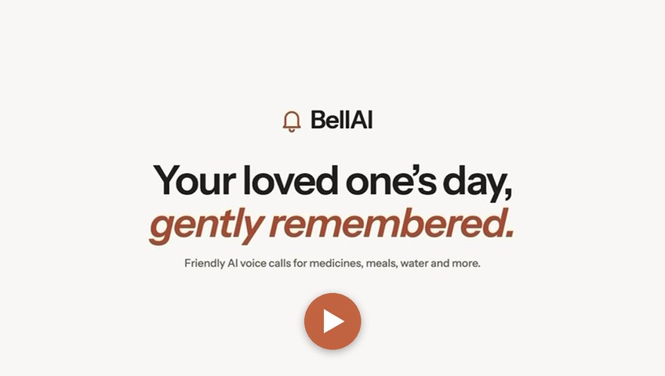

# BellAI - An Asistant That Cares 

Bell AI is an AI-based voice assistant that helps elderly people live independently. It places automated calls to remind them to take medicines on time, attend medical appointments, and complete other essential tasks. Voice AI keeps the conversation natural, so they can respond to reminders, ask questions and confirm tasks are done.

### Introduction Video

[]([frontend/public/videos/intro.mp4](https://bellai-app.vercel.app/videos/intro.webm))

*60-second overview: setting up a reminder, a real BellAI call, and what the family sees afterwards. Click the image to play.*

**Team:** Ayush (caregiver UI, scheduler, retries) · Devesh (voice agent and outbound calls) · Utkarsh (webhooks, outcomes, caregiver alerts, elder and call-log API)

**Stack:** FastAPI (Python) · Next.js (TypeScript) · Bolna voice AI · APScheduler · SQLite

Read [AGENTS.md](AGENTS.md) for ownership, branching and conventions before contributing.

## Repo structure

```
BellAI/
├── AGENTS.md              # roles, branch rules, conventions (read first)
├── docs/architecture.md   # system flow + API contract
├── agent/                 # Bolna voice-agent prompt + config notes
├── backend/               # FastAPI app
│   ├── app/
│   │   ├── main.py        # app factory, router registration, scheduler start
│   │   ├── config.py      # env settings
│   │   ├── db.py          # engine + session
│   │   ├── models.py      # DB tables (shared contract)
│   │   ├── schemas.py     # API request/response models (shared contract)
│   │   ├── routers/       # auth, profiles, tasks, calls, webhooks
│   │   └── services/      # bolna client, scheduler, outcome logic, notifications
│   └── tests/
└── frontend/              # Next.js caregiver web app
    └── src/
        ├── app/           # pages: dashboard, add elder, add task
        └── lib/           # api client + shared types
```

## Quick start

### Backend

```bash
cd backend
python3 -m venv .venv && source .venv/bin/activate
pip install -r requirements.txt
cp .env.example .env          # BOLNA_MOCK=true by default — no real calls
uvicorn app.main:app --reload
```

API docs: http://localhost:8000/docs

### Frontend

```bash
cd frontend
npm install
cp .env.example .env.local
npm run dev
```

App: http://localhost:3000

### Try the full loop without Bolna

1. Add an elder and a task due "now" from the web app (or `/docs`).
2. Within ~30s the scheduler "calls" (mock mode) and the task moves to `calling`.
3. Simulate Bolna's webhook:

```bash
curl -X POST localhost:8000/api/webhook/call-outcome \
  -H 'Content-Type: application/json' \
  -d '{"id": "<bolna_call_id from /api/calls>", "status": "completed",
       "extracted_data": {"outcome": "completed"}}'
```

### Tests

```bash
cd backend && pytest
```
